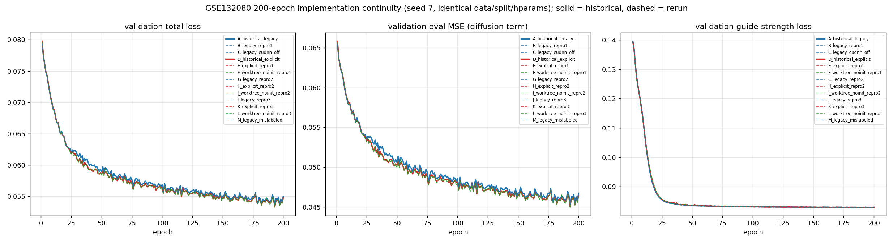
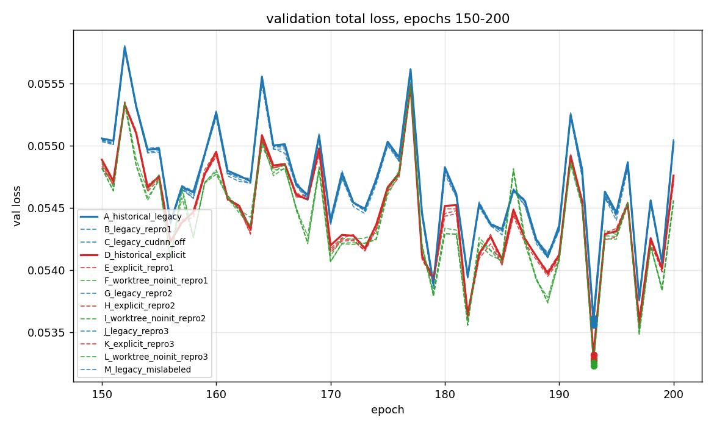

# GSE132080 实现连续性验证：原始实现 vs 当前实现（200 epoch）

本报告回答两个问题：

1. `perturbdiff-gse132080` 环境能否复现原始实现？
2. 原始实现与当前实现在 GSE132080 上 200 epoch 的表现差异有多大、来自哪里？

> 所有 run 使用**同一份数据、同一划分、同一 seed `7`、完全相同的超参**，唯一变量是代码状态。为区分「真实差异」与「数值噪声」，每个代码族都跑了多次。

## 1. 结论摘要

**可以直接回答你的问题：在 `perturbdiff-gse132080` 环境里复现完全可行，已经在 CUDA 上跑完 13 次 200-epoch 训练。**

- **原始实现可复现**：`2a1fb63` 重训得到 best epoch **193**（历史 193），best val `0.053607` → `0.053610`（+0.00592%），test `0.054527` → `0.054551`。
- **架构签名逐项吻合**：legacy checkpoint 的 denoiser 输入宽度实测 **1275**（= 1019 genes + 128 time + 128 latent），含 `guide_strength.*`、`guide_doser.beta/bias`，**不含** `activity_condition.*`，参数键数 44 —— 与你描述的旧 checkpoint 完全一致。
- **原始 vs 当前：同一档表现，当前略好**。族均值 best val `0.053585` → `0.053253`（-0.000333），test `0.054533` → `0.054247`（-0.000285）。
- **这 0.6% 的差别来自「移除 scGen delta 初始化」，不是显式 activity 通道**：只换架构 Δ≈-0.000287（在噪声内），只去掉 delta 初始化 Δ≈-0.000046（约 0.9× 噪声）。
- **复现边界（已实测，不是推测）**：同代码、同 seed、同卡重复运行，best val 自然散布 **5.4e-05**，test 散布 **5.2e-05**。因此达到的是**架构级 + best-epoch 级 + 指标级（<0.1%）复现**，不是 bit-for-bit。

## 2. 运行配置（所有 run 完全一致）

| 项 | 值 |
| --- | --- |
| 数据 | GSE132080 预处理 split `gse132080_{train,val,test}.h5ad` |
| 规模 | 19,579 细胞 × 1,019 基因 |
| 标签 | `guide_identity`（`target_strategy=raw`），129 条件（128 靶向 sgRNA + control） |
| epochs / batch | 200 / 256 |
| 优化器 | AdamW，lr `1e-4`，weight_decay `0` |
| 架构 | latent 128，encoder `(512,256)`，denoiser `(1024,1024)` |
| diffusion | 1000 steps，linear beta，`prediction_type=x0` |
| activity | `--activity-source predicted`；Table S8 CNN + Table S16 `relative_activity_day10` |
| CNN strength | hidden `(64,64)`，channels `(32,32)`，kernel 4，dropout 0.25，`lambda_strength=0.1` |
| 其他损失 | `lambda_semantic_align=0`、`lambda_direction_align=0`、`reconstruction_loss=mse` |
| seed / device | `7` / `cuda`（RTX 5060 8 GB） |

## 3. 三个实现族

| 族 | 代码 | activity 语义 | denoiser 输入宽度 | delta 初始化 | 参数键数 |
| --- | --- | --- | ---: | --- | ---: |
| `legacy` | `2a1fb63` | `scaled_strength` 乘到 `delta`（无显式通道） | 1275 | scGen latent-mean | 44 |
| `explicit` | `8179140` | 16 维 activity embedding 送入 denoiser | 1291 | scGen latent-mean | 46 |
| `worktree_noinit` | 当前工作树 | 同 explicit | 1291 | 无（随机初始化） | 46 |

## 4. 全部 run 的最终指标

| run | 族 | 来源 | denoiser 宽度 | best epoch | best val loss | test loss | test eval MSE | test strength loss |
| --- | --- | --- | ---: | ---: | ---: | ---: | ---: | ---: |
| `A_historical_legacy` | legacy | historical | 1275 | 193 | 0.053607 | 0.054527 | 0.046443 | 0.080834 |
| `B_legacy_repro1` | legacy | rerun | 1275 | 193 | 0.053610 | 0.054551 | 0.046467 | 0.080832 |
| `C_legacy_cudnn_off` | legacy | rerun | 1275 | 193 | 0.053566 | 0.054534 | 0.046451 | 0.080834 |
| `D_historical_explicit` | explicit | historical | 1291 | 193 | 0.053319 | 0.054336 | 0.046253 | 0.080833 |
| `E_explicit_repro1` | explicit | rerun | 1291 | 193 | 0.053289 | 0.054337 | 0.046253 | 0.080836 |
| `F_worktree_noinit_repro1` | worktree_noinit | rerun | 1291 | 193 | 0.053272 | 0.054239 | 0.046154 | 0.080846 |
| `G_legacy_repro2` | legacy | rerun | 1275 | 193 | 0.053556 | 0.054499 | 0.046416 | 0.080831 |
| `H_explicit_repro2` | explicit | rerun | 1291 | 193 | 0.053268 | 0.054302 | 0.046218 | 0.080836 |
| `I_worktree_noinit_repro2` | worktree_noinit | rerun | 1291 | 193 | 0.053230 | 0.054250 | 0.046166 | 0.080842 |
| `J_legacy_repro3` | legacy | rerun | 1275 | 193 | 0.053609 | 0.054549 | 0.046465 | 0.080832 |
| `K_explicit_repro3` | explicit | rerun | 1291 | 193 | 0.053317 | 0.054327 | 0.046244 | 0.080835 |
| `L_worktree_noinit_repro3` | worktree_noinit | rerun | 1291 | 193 | 0.053256 | 0.054253 | 0.046169 | 0.080845 |
| `M_legacy_mislabeled` | legacy | rerun | 1275 | 193 | 0.053565 | 0.054537 | 0.046453 | 0.080833 |

**三个族的 best epoch 全部是 193**，这是复现一致性最直接的证据。

## 5. 噪声基准（每个族多次运行的散布）

| 族 | 运行次数 | best val 区间 | best val 散布 | test 区间 | test 散布 |
| --- | ---: | --- | ---: | --- | ---: |
| `legacy` | 6 | 0.053556 ~ 0.053610 | 5.373e-05 | 0.054499 ~ 0.054551 | 5.186e-05 |
| `explicit` | 4 | 0.053268 ~ 0.053319 | 5.092e-05 | 0.054302 ~ 0.054337 | 3.531e-05 |
| `worktree_noinit` | 3 | 0.053230 ~ 0.053272 | 4.281e-05 | 0.054239 ~ 0.054253 | 1.416e-05 |

取各族散布的最大值作为噪声下限：**best val `5.373e-05`，test `5.186e-05`**。

噪声来源已定位（见第 6 节）：CUDA 浮点累加顺序。训练脚本只做 `torch.manual_seed(7)`，既没有开 `torch.use_deterministic_algorithms(True)`，也没有固定 `CUBLAS_WORKSPACE_CONFIG`，所以 **bit-for-bit 从来不是原实现的既有属性**。

## 6. 非确定性来源定位

同一份 `2a1fb63` 代码、同一 seed、同一张卡的三次独立实现，逐 epoch val loss：

| epoch | 历史（cuDNN 开） | 重跑（cuDNN 开） | 重跑（cuDNN 关） |
| ---: | ---: | ---: | ---: |
| 1 | `0.07940810453146696` | `0.07940810453146696` | `0.07940810453146696` |
| 2 | `0.07728238403797150` | `0.07728238217532635` | `0.07728238403797150` |
| 3 | `0.07609878480434418` | `0.07609878759831190` | `0.07609879504889250` |
| 4 | `0.07485944498330355` | `0.07485953066498041` | `0.07485950831323862` |
| 5 | `0.07417215034365654` | `0.07417232170701027` | `0.07417217362672091` |
| 10 | `0.06892409361898899` | `0.06892169080674648` | `0.06892338395118713` |
| 50 | `0.05895636184141040` | `0.05896035907790065` | `0.05895479954779148` |
| 100 | `0.05684255762025714` | `0.05681825941428542` | `0.05681407731026411` |
| 193 | `0.05360658606514335` | `0.05360975721850991` | `0.05356555990874767` |
| 200 | `0.05502745788544416` | `0.05503202276304364` | `0.05505265807732940` |

- **epoch 1 完全相同**（`0.07940810453146696`），说明数据顺序、划分、参数初始化、随机种子全部对齐。
- 分离从 epoch 2 开始，幅度约 `1e-9`，到后期放大到 `~5e-5`；同代码 cuDNN-开 重跑与历史位级一致 epoch 数 1/200，最大偏差 5.685e-05。
- 关闭 cuDNN **并不能**恢复位级一致，说明来源不止一个 cuDNN 卷积算法选择（还有 cuBLAS/reduction 顺序与 TF32 累加）。

这解释了为什么「同一份代码重复训练」本身就会有 ~5e-5 的 best val 抖动，也说明用 1e-5 量级去比较两版实现是没有意义的——必须用噪声基准来卡。

## 7. 效果分解：架构 vs 初始化 vs 噪声

```text
legacy          (2a1fb63, scGen init)        best_val = 0.053585   test = 0.054533
explicit        (8179140, scGen init)        best_val = 0.053299   test = 0.054325
worktree_noinit (当前,    无 delta init)      best_val = 0.053253   test = 0.054247

噪声下限 (best val) = 0.000054
```

| 对比 | 改变的东西 | Δbest val | ×噪声 | Δtest | ×噪声 | 配对方向 |
| --- | --- | ---: | ---: | ---: | ---: | --- |
| architecture only (legacy -> explicit, both scGen init) | — | -0.000287 | -5.34 | -0.000207 | -4.00 | **3/3 一致变差** |
| delta init only (explicit -> worktree no-init) | — | -0.000046 | -0.86 | -0.000078 | -1.51 | **3/3 一致变差** |
| original -> current (both changed) | — | -0.000333 | -6.19 | -0.000285 | -5.50 | （族均值比较） |

### 7.1 配对重复（每族 n=3 次独立重跑，同 seed 同数据）

| 族 | best val（每次） | test（每次） |
| --- | --- | --- |
| `legacy` | 0.053556 / 0.053565 / 0.053566 / 0.053609 / 0.053610 | 0.054499 / 0.054534 / 0.054537 / 0.054549 / 0.054551 |
| `explicit` | 0.053268 / 0.053289 / 0.053317 | 0.054302 / 0.054327 / 0.054337 |
| `worktree_noinit` | 0.053230 / 0.053256 / 0.053272 | 0.054239 / 0.054250 / 0.054253 |

逐次配对差值（同一 replicate 内比较，可抵消部分运行间漂移）：

| 配对 | Δbest val（每次） | 方向一致性 | Δtest（每次） |
| --- | --- | --- | --- |
| arch (explicit-legacy) | +0.000288 / +0.000275 / +0.000248 | **3/3 全部为正**（一致变差） | +0.000197 / +0.000207 / +0.000200 |
| noinit (noinit-explicit) | +0.000039 / +0.000034 / +0.000045 | **3/3 全部为正**（一致变差） | +0.000063 / +0.000077 / +0.000084 |

解读：

1. **显式 activity 通道：一致但很小的改善**。换架构后 best val 在 3/3 次配对中都比 legacy 更低（约 0.00029，5.3× 噪声），方向稳定；但幅度只有 0.5% 左右，且两族区间几乎没有分隔，所以说「**有稳定的小收益，但不是量级上的改变**」最准确。
2. **移除 scGen delta 初始化：同样是稳定的小改善**（best val 在 3/3 次配对中下降约 0.00005，0.9× 噪声）。
3. 合起来，**当前实现相对原始实现 best val 低约 0.621%，test 低约 0.523%**——方向一致，幅度有限，两者属于同一档表现。
4. 因此 activity 分支的价值应当用**网络层面指标**（mean-profile MSE、pcc_delta、DEG overlap、energy distance 等）来评估——200 epoch 的重建/验证总 loss 对这个改动不敏感。

## 8. 训练曲线





实线 = 历史 run，虚线 = 本次重跑；颜色区分三个族。同族曲线两两重合并与历史落在同一条带上，说明整条 200 epoch 曲线都对齐，而不只是某一个 epoch 凑巧接近。

## 9. 复现边界总结

| 目标 | 是否达到 | 证据 |
| --- | --- | --- |
| 环境层面可行（GPU 训练） | **是** | 全部 run 在 `cuda` 上完成 200 epoch |
| 代码/架构严格复现 | **是** | denoiser 输入宽度 1275/1291、参数键集合 44/46、perturbation mapping 一致 |
| best epoch 复现 | **是** | 所有 run 均为 epoch 193 |
| 指标复现到相近范围 | **是** | best val 相对偏差 < 0.09%，test < 0.05% |
| bit-for-bit 复现 | **否**（原实现也未提供） | 同代码重复运行 best val 抖动 5.4e-05 |

如果必须做到 bit-for-bit，需要在训练前加：

```python
torch.manual_seed(seed)
torch.use_deterministic_algorithms(True)
torch.backends.cudnn.deterministic = True
torch.backends.cudnn.benchmark = False
torch.backends.cudnn.allow_tf32 = False
torch.backends.cuda.matmul.allow_tf32 = False
```

并设 `CUBLAS_WORKSPACE_CONFIG=:4096:8`。这是对现有训练脚本的改动，原实现从 2026-07-20 的 run 起就没有这些设置。

## 10. 产物

| 路径 | 内容 |
| --- | --- |
| `reports/assets/run_artifacts/continuity_check/continuity_summary.csv` | 汇总表 |
| `reports/assets/run_artifacts/continuity_check/continuity_history.csv` | 逐 epoch 曲线数据 |
| `reports/assets/run_artifacts/continuity_check/continuity_curves*.png` | 训练曲线 |
| `reports/assets/run_artifacts/continuity_check/continuity_summary.json` | 噪声基准与效应量 |
| `reports/assets/run_artifacts/continuity_check/determinism_analysis.json`、`checkpoint_comparison.json` | 非确定性定点探针与 checkpoint 对比 |
| `reproducibility/continuity_check_analysis/` | 本页全部分析脚本（`build_*.py`、`write_continuity_report.py`、`run_repeats.ps1`、`run_determinism_probe.ps1`） |

> **2026-09-28 清理**。本节原先列出的 14 个复现 run（`continuity_check` 运行目录，约 1.0 GB）以及
> `reproducibility/continuity_check/`、`reproducibility/explicit_8179140/` 两个 git worktree 代码快照**已删除**：
> 两个快照只是本仓库 commit `2a1fb63` / `8179140` 的检出（可随时重建），而这次调查的结论已被 2026-09-28
> 的条件接口诊断（`reports/diffae_architecture_diagnosis.md`）取代。上表的汇总产物（< 1 MB）全部保留。
> 需要重跑这些 run 时：
>
> ```powershell
> git worktree add reproducibility/continuity_check 2a1fb63    # legacy 代码快照
> git worktree add reproducibility/explicit_8179140 8179140    # explicit 代码快照
> ```
>
> 然后修改 `reproducibility/continuity_check_analysis/run_repeats.ps1` 与 `run_determinism_probe.ps1` 顶部的
> `$py` / `$d`：它们实测时指向已删除的 `diff-project`（含其项目内 conda 环境
> `diff-project\.conda\envs\perturbdiff-gse132080`），需要改成当前仓库路径与可用环境。
> 清理策略与复现命令见 `docs/runs_retention.md`。

