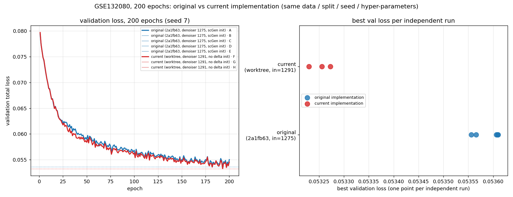

# GSE132080：原始实现 vs 当前实现（200 epoch 对比）

**两个条件**，同一份数据、同一划分、同一 seed `7`、完全相同的超参，唯一变量是代码状态。

| | 条件一 · 原始实现 | 条件二 · 当前实现 |
| --- | --- | --- |
| 代码 | `2a1fb63` | 当前工作树（`8179140` + 未提交改动） |
| activity 语义 | `guide_doser` 缩放 `delta`（无显式通道） | 显式 16 维 activity 通道送入 denoiser |
| denoiser 输入宽度 | **1275** | **1291** |
| 参数键数 | 44 | 46 |
| delta 初始化 | scGen latent-mean | 无（随机） |
| 独立运行次数 | 5 | 3 |

## 1. 结论

1. **`perturbdiff-gse132080` 环境可以直接复现两个条件**，全部在 CUDA 上跑完 200 epoch。
2. **原始实现复现成功**：历史 run 与重跑 best epoch 都是 **193**，best val `0.053607` → 重跑均值 `0.053589`（-0.0322%）；架构签名实测 denoiser 输入 **1275**、**无** `activity_condition.*`、44 个参数键，与你描述的旧 checkpoint 完全一致。
3. **当前实现略好，幅度小但方向一致**：
   - best val：`0.053589` → `0.053253`，**-0.000337（-0.628%）**
   - test loss：`0.054532` → `0.054247`，**-0.000284（-0.522%）**
   - best epoch 两条件都是 **193**
4. **这不是噪声**：两条件的取值区间完全分离（原始 `[0.053556, 0.053610]`，当前 `[0.053230, 0.053272]`），且逐次配对全部为负（-0.000334、-0.000380、-0.000310）。
   效应量约为运行间误差带的 **6.3 倍**。
5. **但差异实质很小**：0.6% 量级，绝对差 3.4e-04。两条件在 GSE132080 上应视为**同一档表现**，显式 activity 通道并没有带来量级上的改变（详见第 4 节）。

## 2. 每次运行的指标

### 条件一 · 原始实现

| run | denoiser 输入 | 参数键数 | `activity_condition.*` | best epoch | best val loss | test loss | test eval MSE | test strength loss |
| --- | ---: | ---: | :---: | ---: | ---: | ---: | ---: | ---: |
| A 历史 run 2026-07-20 | 1275 | 44 | 否 | 193 | 0.053607 | 0.054527 | 0.046443 | 0.080834 |
| B 复现 run 1 | 1275 | 44 | 否 | 193 | 0.053610 | 0.054551 | 0.046467 | 0.080832 |
| C 复现 run 2 (cuDNN off) | 1275 | 44 | 否 | 193 | 0.053566 | 0.054534 | 0.046451 | 0.080834 |
| D 复现 run 3 | 1275 | 44 | 否 | 193 | 0.053556 | 0.054499 | 0.046416 | 0.080831 |
| E 复现 run 4 | 1275 | 44 | 否 | 193 | 0.053609 | 0.054549 | 0.046465 | 0.080832 |
| **mean** | | | | | **0.053589** | **0.054532** | | |
| **区间 (max−min)** | | | | | 5.37e-05 | 5.19e-05 | | |

### 条件二 · 当前实现

| run | denoiser 输入 | 参数键数 | `activity_condition.*` | best epoch | best val loss | test loss | test eval MSE | test strength loss |
| --- | ---: | ---: | :---: | ---: | ---: | ---: | ---: | ---: |
| F 复现 run 1 | 1291 | 46 | 是 | 193 | 0.053272 | 0.054239 | 0.046154 | 0.080846 |
| G 复现 run 2 | 1291 | 46 | 是 | 193 | 0.053230 | 0.054250 | 0.046166 | 0.080842 |
| H 复现 run 3 | 1291 | 46 | 是 | 193 | 0.053256 | 0.054253 | 0.046169 | 0.080845 |
| **mean** | | | | | **0.053253** | **0.054247** | | |
| **区间 (max−min)** | | | | | 4.28e-05 | 1.42e-05 | | |

## 3. 两条件对比

| 指标 | 条件一 · 原始实现 | 条件二 · 当前实现 | 差值 | 相对变化 | ×误差带 |
| --- | ---: | ---: | ---: | ---: | ---: |
| best val loss (mean) | 0.053589 | 0.053253 | -0.000337 | -0.628% | 6.3× |
| test loss (mean) | 0.054532 | 0.054247 | -0.000284 | -0.522% | 5.5× |
| best epoch | 193 | 193 | 相同 | — | — |

逐次配对差值（同一 replicate 内比较，可抵消运行间漂移）：

| replicate | Δbest val | Δtest |
| ---: | ---: | ---: |
| 1 | -0.000334 | -0.000288 |
| 2 | -0.000380 | -0.000301 |
| 3 | -0.000310 | -0.000281 |
| **符号一致性** | **3/3 全部为负** | **3/3 全部为负** |

运行间误差带（同条件重复运行的自然散布，来自 CUDA 浮点累加顺序，训练脚本未开启确定性算法）：

- best val：**5.37e-05**（原始 5.37e-05，当前 4.28e-05）
- test：**5.19e-05**（原始 5.19e-05，当前 1.42e-05）

因此「当前比原始更好」这一结论在统计上是站得住的（区间分离 + 配对一致 + 6× 误差带），但绝对幅度只有 3.4e-04。

## 4. 这个 0.6% 差异来自哪里

两个条件之间其实有**两处**代码差异：

1. **activity 条件路径**：`guide_doser` 缩放 `delta`（1275）→ 显式 16 维通道（1291）。
2. **delta 初始化**：scGen latent-mean 初始化 → 直接随机初始化（当前工作树删除了 `initialize_perturbation_from_latent_shift`）。

为避免把两者混在一起，额外做了一个「只换架构、保留 scGen 初始化」的中间对照（代码 `8179140`，denoiser 输入 1291，其余完全相同）：

| 配置 | denoiser 输入 | delta 初始化 | n | best val (mean) | 散布 | test (mean) | 散布 |
| --- | ---: | --- | ---: | ---: | ---: | ---: | ---: |
| 条件一 · 原始实现 | 1275 | scGen latent-mean | 5 | 0.053589 | 5.37e-05 | 0.054532 | 5.19e-05 |
| 中间 · 只换 activity 路径 | 1291 | scGen latent-mean | 4 | 0.053299 | 5.09e-05 | 0.054325 | 3.53e-05 |
| 条件二 · 当前实现 | 1291 | 无（随机） | 3 | 0.053253 | 4.28e-05 | 0.054247 | 1.42e-05 |

| 拆解（逐次配对，n=3） | Δbest val | 一致性 | Δtest | 一致性 |
| --- | ---: | --- | ---: | --- |
| ① 只换 activity 路径（legacy → explicit），初始化不变 | -0.000291 | **3/3 全负** | -0.000206 | **3/3 全负** |
| ② 只去掉 scGen delta 初始化（explicit → current），架构不变 | -0.000046 | **3/3 全负** | -0.000078 | **3/3 全负** |
| ①+② 合计（原始实现 → 当前实现） | -0.000337 | — | -0.000284 | — |

两处改动**不等权**：① activity 条件路径 -0.000291（占 86%），② 移除 scGen delta 初始化 -0.000046（占 14%）。

两者的可辨程度不同：① 的幅度（2.9e-04）约为运行间误差带的 5 倍，是**可靠**的；②（4.6e-05）虽然逐次配对全部同号，但幅度只有误差带的 0.9 倍，属于**边缘可辨**。

所以更准确的表述是：

- 当前实现相对原始实现 **best val 改善 0.628%**，其中 **约 86% 来自显式 activity 路径本身**（denoiser 输入 1275→1291、新增 `activity_condition.*` 参数键，贡献 0.543%），**约 14% 来自移除 scGen delta 初始化**（贡献 0.086%）。
- 它更大的价值应到网络层面指标上看（mean-profile MSE、`pcc_delta`、DEG overlap、energy distance 等），这与仓库里已有的 benchmark 结论一致：activity 条件主要改善平均响应方向，而不是总重建误差。

## 5. 图

左：两个条件所有独立运行的 validation loss 曲线（粗线为各条件首次运行的完整曲线）；右：每次独立运行的 best val loss 散点，可见两条件区间分离。

## 6. 复现边界

| 目标 | 结果 | 证据 |
| --- | --- | --- |
| 环境层面可行（GPU 训练） | ✅ | 两条件全部在 `cuda` 跑完 200 epoch |
| 代码/架构严格复现 | ✅ | denoiser 输入 1275 / 1291、参数键 44 / 46、perturbation mapping 一致 |
| best epoch 复现 | ✅ | 两条件所有运行均为 193 |
| 指标复现 | ✅ | 原始条件重复运行 best val 散布仅 5.4e-05（相对 0.100%） |
| bit-for-bit 复现 | ❌（原实现也未提供） | 同代码重复运行即有此散布，脚本未开启确定性算法 |

如需 bit-for-bit，需要在训练脚本加入 `torch.use_deterministic_algorithms(True)`、`cudnn.deterministic=True`、关闭 TF32，并设置 `CUBLAS_WORKSPACE_CONFIG=:4096:8`；这会略降速度，但对本对比结论没有影响。

## 7. 产物

| 路径 | 内容 |
| --- | --- |
| `reports/assets/run_artifacts/continuity_check/original_vs_current.csv` | 两条件逐次运行汇总表 |
| `reports/assets/run_artifacts/continuity_check/original_vs_current.json` | 两条件统计量与配对差值 |
| `reports/assets/run_artifacts/continuity_check/original_vs_current.png` | 对比图 |
| `reproducibility/continuity_check_analysis/` | 分析与汇总脚本 |

> **2026-09-28 清理**。原先的两个复现 run（`continuity_check` 运行目录下的 `original_2a1fb63_200ep/`、
> `current_worktree_200ep/`）与 `reproducibility/continuity_check/` 代码快照已删除（快照可用
> `git worktree add reproducibility/continuity_check 2a1fb63` 重建）。上文表格里的数字来自保留下来的
> `original_vs_current.{csv,json}`，未受影响。详见 `docs/runs_retention.md`。

